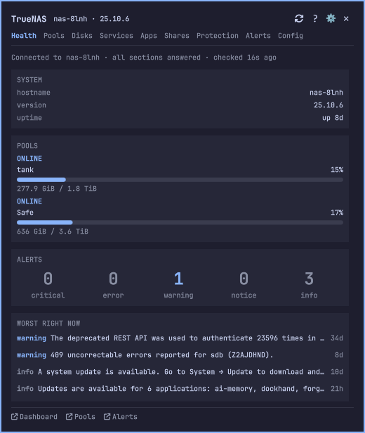
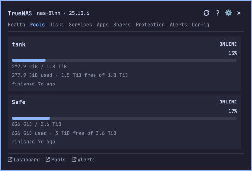
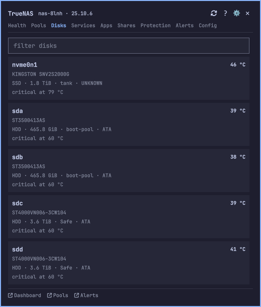
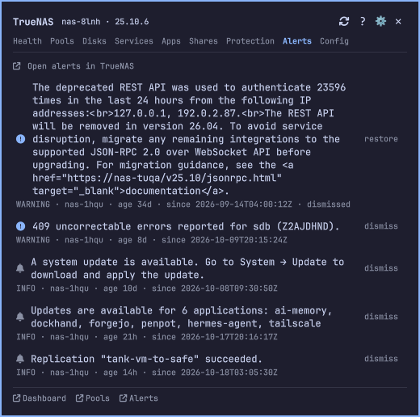
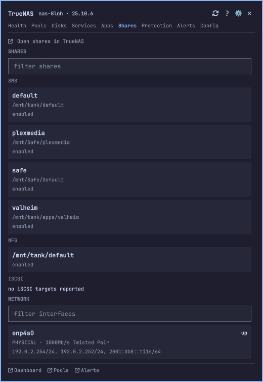
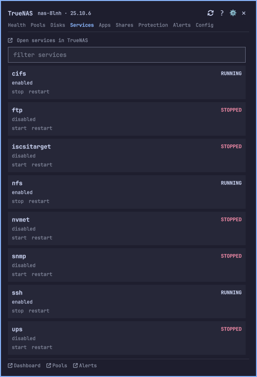
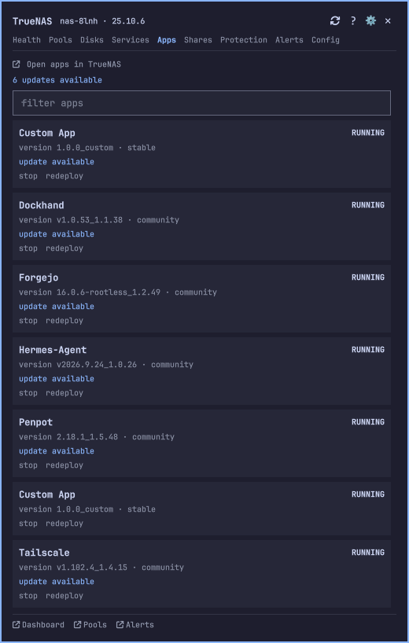
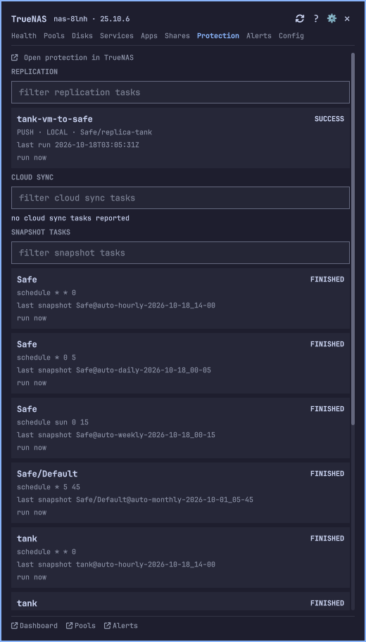
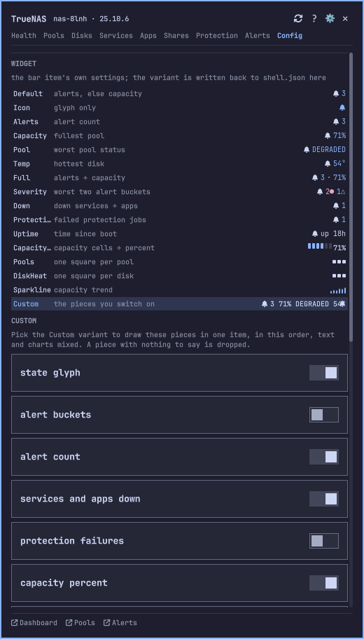

# TrueNAS for Omarchy

TrueNAS pool health, disk temperatures and active alerts on the Omarchy bar, with
desktop notifications when something degrades and a popout that also covers
protection, shares and network.



Verified against a live TrueNAS 25.10.6 with two pools, real alert levels and a
self-signed certificate. Every capture is that machine, taken at `redact:
network` so addresses and hostnames print as stable fakes.

| Pools | Disks | Alerts | Shares |
| --- | --- | --- | --- |
| [](docs/screenshots/pools.png) | [](docs/screenshots/disks.png) | [](docs/screenshots/alerts.png) | [](docs/screenshots/shares.png) |

| Services | Apps | Protection | Config |
| --- | --- | --- | --- |
| [](docs/screenshots/services.png) | [](docs/screenshots/apps.png) | [](docs/screenshots/protection.png) | [](docs/screenshots/config.png) |

## What it does

**The bar item.** One widget, sixteen variants, selectable in Setup > Plugins.
Text variants print the active alert count (or the fullest pool's capacity when
nothing is firing), the worst pool status, the hottest disk, uptime, and more.
Chart variants draw in the icon slot: a capacity bar, one square per pool, a disk
heat map, a capacity sparkline. `Custom` composes the pieces you switch on. The
item is tinted by the worst state. An unreachable NAS shows a plug and an
unconfigured one a cog, so "nothing is wrong" and "I cannot tell" never look the
same. You can add the item to the bar more than once, each with its own variant;
all share the one poll.

**The popout.** Nine tabs: Health, Pools, Disks, Services, Apps, Protection,
Shares (which also shows network interfaces), Alerts and Config. Health carries
the connection, hostname, version, uptime, capacity and alert counts; Pools adds
scrub state and vdev errors; Disks shows a card per disk. Services, apps and
protection tasks can be controlled from here, each behind a confirmation. Shares
and network are read-only.

**Notifications.** A toast when an alert starts or clears, when a pool leaves or
returns to `ONLINE`, when a disk crosses a temperature band and cools back, when
a service or app goes down or returns, and when a replication or cloud sync task
fails or recovers. Toasts are deduped, so a network blip does not replay them.

**The CLI.** `truenasctl` is the terminal side. See below.

## Requirements

- Omarchy with plugin support (Quickshell).
- TrueNAS SCALE 25.10. The REST `/api/v2.0` API this plugin uses is removed in
  TrueNAS 26; see [docs/websocket-migration.md](docs/websocket-migration.md).
- One NAS and one API key.

## Install

The plugin is not published yet. There is no marketplace listing and no public
repository, so install from a local checkout:

```
./scripts/dev-install --restart
```

`--restart` is needed because the shell caches compiled QML per URL; a rescan
alone does not reload an open panel. If the plugin is published later, the
marketplace listing and
`omarchy plugin add https://github.com/h4ad/omarchy-truenas.git --enable` are the
intended paths.

## Setup

Point the plugin at your NAS. The API key is read on stdin so it never reaches
the command line:

```
truenasctl login https://<host>[:<port>]
```

The key is stored at mode 600. After login, the bar and popout read the state the
poller writes. Add `--insecure` to `login` only if your NAS uses a self-signed
certificate your desktop does not trust.

## The CLI

```
truenasctl login|logout|test [-v]|status|poll
truenasctl alerts|pools|disks|services|apps
truenasctl replication|cloudsync|snapshots|scrubs|shares|network
truenasctl config list|set|set-key
truenasctl open|purge
```

`test -v` steps through the connection and names the failure (TLS, no key, key
rejected, forbidden, not JSON, timed out) rather than reporting a generic error.
`purge` deletes the config, credentials and state.

## Configuration

Settings live in `~/.config/omarchy/truenas/config.json`. The panel shows them;
the bar variant, the API key and the redaction level are editable there.
`baseUrl` is written by `login`, `insecureTLS`, `pollSeconds`, `timeoutSeconds`
and `redact` by `truenasctl config set`, and the `notify` block by hand.

| Key | Default | Meaning |
| --- | --- | --- |
| `baseUrl` | | NAS address, from `login` |
| `pollSeconds` | 30 | Fast poll interval, floored at 15 (the API rate limit) |
| `timeoutSeconds` | 8 | Per-request timeout |
| `insecureTLS` | false | Skip certificate verification (explicit opt-in) |
| `redact` | off | Display-only: hide identifying values for recording |
| `notify.levels` | critical, error, warning | Alert levels that toast |

The bar item's own settings (variant, `hideWhenHealthy`, `panelWidth`) are
stored by the shell in `shell.json`, not here.

## Security

Short answers to the questions a reader, or an auditor, is likely to ask.

**Where is my API key stored?** In `~/.config/omarchy/truenas/credentials`, mode
600, inside a directory created mode 700. It is written atomically by
`truenasctl login` or `config set-key`, never into `shell.json`, never on a
command line, never in an environment variable, never in a log. `config list`
prints only whether a key is set.

**How is the key sent?** As `Authorization: Bearer <key>` to the one base URL you
configure, over HTTPS. The header is handed to curl through a stdin config
document (`--config -`), not argv, so no other process of your user can read it
from `ps`. TrueNAS revokes keys sent over plain HTTP, so the base must be
`https`. If you prefer a password manager, `apiKeyCommand` in `config.json` names
a command to fetch the key instead of storing it.

**Does anything leave my machine besides the NAS?** No. The plugin is an outbound
HTTPS client to your NAS and nothing else: no telemetry, no analytics, no
third-party endpoint, no listener, no webhook, no inbound port. Links out to the
NAS UI are built from your base URL, and a URL that arrives from the NAS is
admitted only if it stays on that origin, so it cannot be pointed elsewhere
through a host suffix or `@` userinfo.

**What about the self-signed certificate?** `insecureTLS` is an explicit opt-in.
Only a literal `true` makes curl skip verification; missing, false or a wrong
type means verify. Prefer trusting the NAS certificate in your system store over
turning this on.

**Do I have to trust my NAS?** No. Everything the NAS sends is treated as
untrusted input. Poll-derived strings render as plain text, never rich text, so a
pool name or alert cannot inject markup or trigger an outbound image load.
Control bytes are stripped from anything printed to a terminal and from
everything written to the state files, so a crafted alert cannot rewrite your
terminal (OSC 52, title spoofing, fake output). A number the poll could not read
is shown as "unknown", never as a fabricated zero.

**Can a compromised NAS run commands on my desktop or steal the key?** No, with
one documented exception you control. No shell command is built from NAS or poll
data. Notifications receive their arguments as separate argv words, never as a
shell string. `xdg-open` receives only origin-gated URLs. The one
command-execution path is `apiKeyCommand` in `config.json`, a command you write
yourself; it runs only to fetch the key, and if you do not set it nothing runs.

**What does it write to disk?** Config and key under
`~/.config/omarchy/truenas/`. Poll state under `~/.local/state/omarchy/truenas/`
(`state.json`, `meta.json`, `history.json`, `seen.json`). The poller whitelists
fields before caching, so disk serials, replication SSH credentials and
encryption keys, cloud sync secrets, app image ids and notes, SMB audit/options
blobs, NFS hosts/networks, iSCSI parameters and interface MACs never reach disk.

**Can I record a demo without showing my hostname or pool names?** Set `redact` to
`network`, `names` or `all` (`truenasctl config set redact names`, or the Config
tab). It is display only: the bar, menu and panel print a stable fake for the
values each level hides, while `config.json`, the credentials file and every
state file keep the real ones, and links still open the real NAS. `network` hides
addresses, hostnames and the base URL; `names` adds pools, datasets, shares,
apps, disks, interfaces and tasks; `all` adds the version and hides free-form
alert text. An address or a URL host written inside prose, which is where an
alert lists the clients that hit the API, is faked too, even when it appears in
no field. Use it for a recording, then set it back to `off`.

**What can it change on the NAS?** Only what you confirm in the popout:
start, stop or restart a service, start, stop or redeploy an app, dismiss or
restore an alert, run a replication, cloud sync, snapshot or scrub task, and
write the API key or a local setting. Each is one confirmed action. There is no
pool, dataset or share editing, no bulk action and no remote shell.

**What is the trust boundary?** The plugin runs unsandboxed inside your
Quickshell session, as you. Any process running as your user, or anything that
can read your home directory, is outside the model: it can already read the
credentials file and the state files. The plugin has no auth layer of its own.
TLS interception and the NAS itself are out of scope, except for the explicit
`insecureTLS` opt-out.

**How do I audit it?** The security-relevant code is small and concentrated:

- `bin/truenas-lib.sh`: key resolution and the single HTTP request shim.
- `Links.js`: the origin gate for every outbound link.
- `share/normalize.jq`: the field whitelist applied to every wire response.
- `Panel.qml` and `Ui/ConfirmAction.qml`: the confirmation gate for writes.
- `bin/truenas-poll` `notify()`: the argv contract for notifications.
- `docs/pitfalls.md`: the traps that cost time, including the security ones.

## How it works

`Service.qml` owns the only poll timer. It runs `bin/truenas-poll`, which reads
the NAS over one HTTP shim (`tn_http_request`), normalizes the wire shapes with
`share/normalize.jq`, writes the state files, and sends notifications. The bar
widget, menu and popout read the state files. Writes go through `bin/truenas-api`
and then a forced re-poll, so the panel reads the NAS back rather than trusting
the verb's own answer.

Every request goes through the one shim, so the move off the deprecated REST API
to the JSON-RPC websocket API is a change in one place. See
[docs/websocket-migration.md](docs/websocket-migration.md).

## Docs

- What ships: [docs/features.md](docs/features.md)
- The TrueNAS API surface: [docs/truenas-api.md](docs/truenas-api.md)
- The traps that have already cost time: [docs/pitfalls.md](docs/pitfalls.md)
- How Omarchy plugins work: [docs/omarchy-plugin-api.md](docs/omarchy-plugin-api.md)
- Off the deprecated REST API: [docs/websocket-migration.md](docs/websocket-migration.md)
- Tests: [tests/README.md](tests/README.md)

## License

MIT. See [LICENSE](LICENSE).
