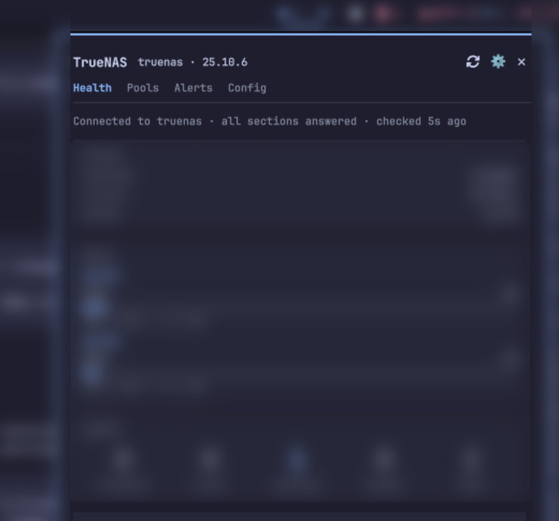

# TrueNAS for Omarchy

TrueNAS pool health, disk temperatures and active alerts on the Omarchy bar, with
desktop notifications when something degrades and a popout that also covers
protection, shares and network.



Verified against a live TrueNAS 25.10.6 (two pools, real alert levels, the
self-signed certificate handled through `insecureTLS`).

## What the bar shows

One widget, fifteen variants. The text variants are `Default` (the active alert
count when anything is firing, otherwise the fullest pool's capacity), `Icon`,
`Alerts`, `Capacity`, `Pool`, `Temp`, `Full`, `Severity` (the worst two alert
buckets, each tinted by its own level), `Down` (services and apps not running),
`Protection` (failed protection jobs) and `Uptime`. The charts draw in the icon
slot: `CapacityBar` (cells filled to the fullest pool's used percent, with the
percent), `Pools` (one square per pool by status), `DiskHeat` (one square per
disk by temperature band) and `Sparkline` (the fullest pool's recent capacity).
The item is tinted by the worst state, and an unreachable NAS shows a plug while
an unconfigured one shows a cog, so "nothing is wrong" and "I cannot tell" never
look the same. Add it to the bar more than once, each with its own variant, to
show several things at once; all the items share the one poll.

## What the popout shows

Nine tabs. Health has connection state and last-poll age, hostname, version,
uptime, pool capacity and alert counts. Pools shows a capacity bar, status, scrub
state and vdev errors per pool. Disks shows one card per disk with its
temperature, model and pool. Services and Apps show state, with start, stop,
restart and redeploy each behind a confirmation. Shares and Network are
read-only. Protection covers replication, cloud sync, snapshot and scrub tasks,
with run-now for each. Alerts lists a row per alert with dismiss and restore
where the alert allows it. Config holds the bar settings and the NAS read-out.

## Notifications

A toast when an alert starts firing or clears, when a pool leaves or returns to
`ONLINE`, when a disk crosses into the warning or critical band and cools back,
when a service or app goes down or returns, and when a replication or cloud sync
task fails or recovers. Toasts are deduped in `seen.json`, so a network blip does
not replay them as new.

## The CLI

`truenasctl` is the terminal side: `login`, `logout`, `test [-v]`, `status`,
`alerts`, `pools`, `disks`, `services`, `apps`, `replication`, `cloudsync`,
`snapshots`, `scrubs`, `shares`, `network`, `poll`, `config list|set|set-key`,
`open` and `purge`.

## Install

The plugin is not published yet: there is no marketplace listing and no public
repository, so install from a local checkout:

```
./scripts/dev-install --restart
```

If it is published later, the marketplace listing and
`omarchy plugin add https://github.com/h4ad/omarchy-truenas.git --enable` will be
the install paths. That URL is the intended home, not a live repository today.

## Setup

Point the plugin at your NAS and store the API key at mode 600:

```
truenasctl login https://<host>[:<port>]
```

The key is read on stdin, so it never reaches the command line. After login the
bar and popout read the state the poller writes.

## Security notes

A self-signed certificate is the norm, which is why `insecureTLS` exists; enable
it for a NAS whose certificate your desktop does not trust. TrueNAS REST
`/api/v2.0` is deprecated and removed in TrueNAS 26, so every call goes through
one helper, `tn_call`/`tn_http_request`, the migration seam to the newer API. The
key reaches curl only through a stdin document: never argv, never `shell.json`,
never a log.

## Requirements

TrueNAS 25.10, one NAS, one API key.

## Docs

- What ships and what does not: [docs/03-features.md](docs/03-features.md)
- The TrueNAS API surface: [docs/02-truenas-api.md](docs/02-truenas-api.md)
- The traps that have already cost time: [docs/11-pitfalls.md](docs/11-pitfalls.md)
- The handoff, including the shapes that were never measured live:
  [docs/04-handoff.md](docs/04-handoff.md)

## License

MIT. See [LICENSE](LICENSE).
